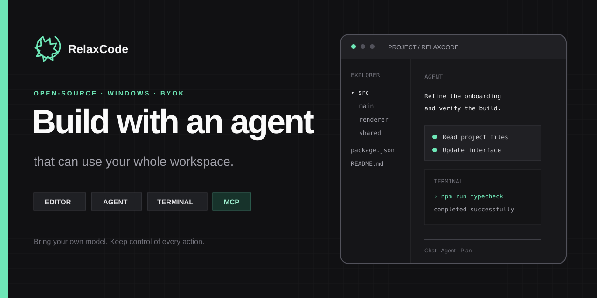
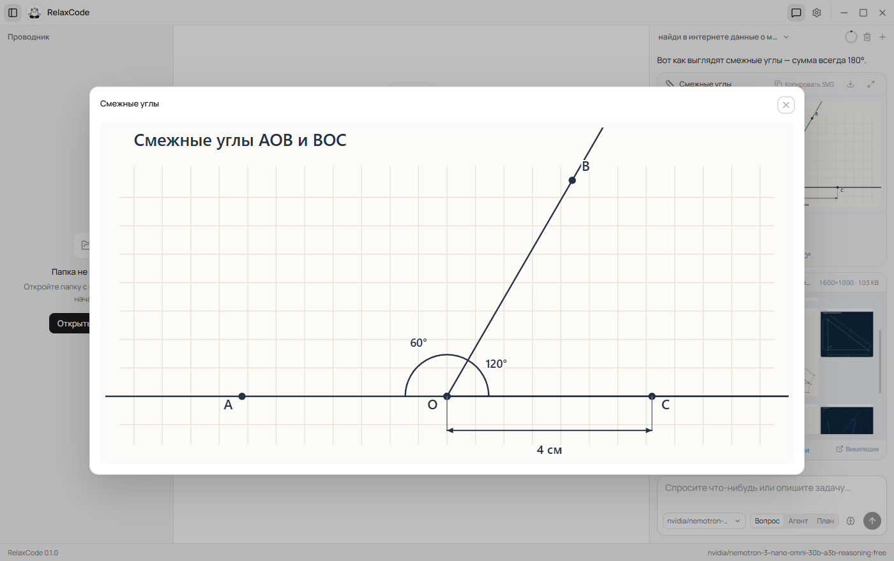
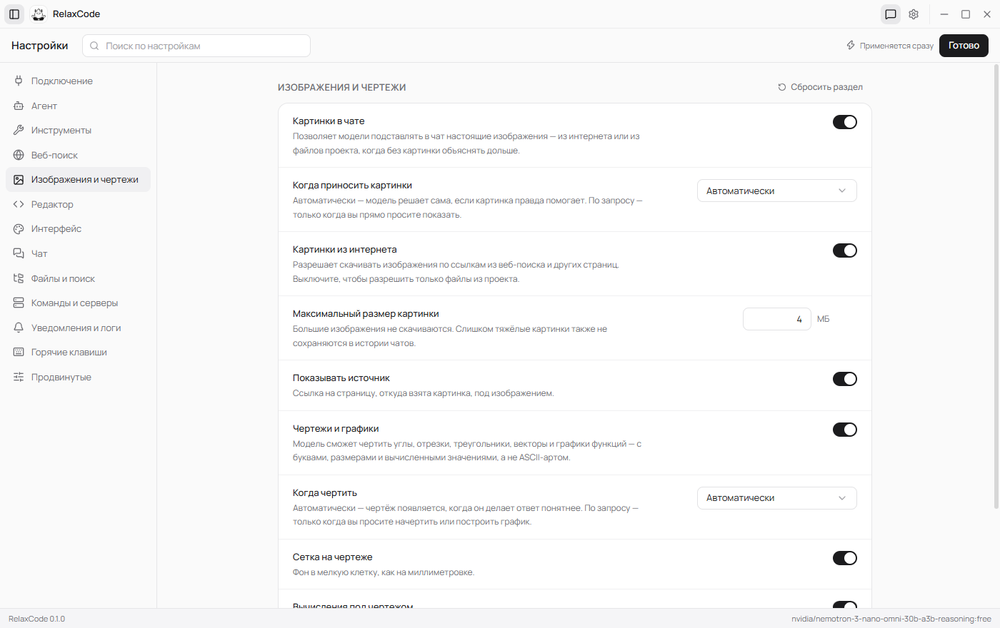
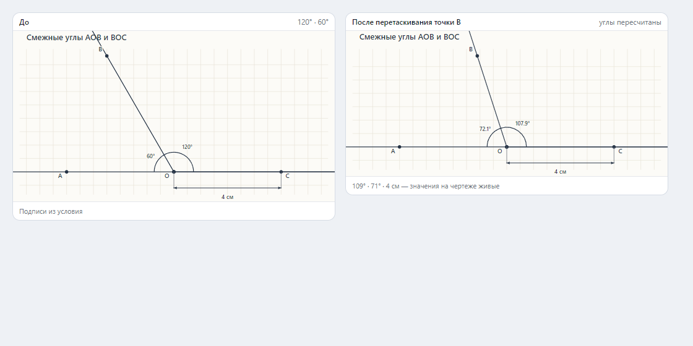

<div align="center">



Настольная IDE с ИИ-агентом: редактор кода, файлы, терминал и чат в одном приложении.

[](https://github.com/mikkya2123-ship-it/RelaxCode/releases/latest)
[](LICENSE)
[](#разработка)

**[Скачать для Windows](https://github.com/mikkya2123-ship-it/RelaxCode/releases/latest)** · [Возможности](docs/FEATURES.md) · [Сообщить об ошибке](https://github.com/mikkya2123-ship-it/RelaxCode/issues/new?template=bug_report.yml)

</div>

<p align="center">
  <a href="#интерфейс">Интерфейс</a> ·
  <a href="#начало-работы">Начало работы</a> ·
  <a href="#разработка">Разработка</a> ·
  <a href="docs/RELEASING.md">Релизы</a>
</p>

---

## От задачи к изменениям в проекте

Откройте папку, подключите ИИ-провайдера и опишите задачу. Агент может изучать код, изменять файлы и запускать команды. Редактор Monaco, дерево проекта и результаты выполнения остаются под рукой.

| Возможность | Что вы получаете |
| :--- | :--- |
| **Чат, агент и план** | Обсуждение идеи, работа с проектом или подготовка плана |
| **Свои модели и API-ключи** | Выбор провайдера и модели в настройках |
| **Файлы и терминал** | Редактирование кода, поиск, команды и фоновые серверы |
| **Контроль действий** | Подтверждения инструментов, пауза, остановка и очередь задач |
| **Приложения через MCP** | Подключение внешних инструментов, включая Blender |
| **Визуальные ответы** | Изображения, интерактивные схемы и графики прямо в чате |

## Интерфейс

Снимки светлой темы из версии 0.1.0. В текущей версии отдельные элементы могут отличаться.

### Схемы прямо в диалоге

Откройте чертёж в крупном просмотре, чтобы рассмотреть подписи и размеры.



<details>
<summary><strong>Настройки изображений и чертежей</strong></summary>

Управление визуальными ответами: изображения из интернета, размеры файлов, источники и сетка чертежа.



</details>

<details>
<summary><strong>Интерактивная геометрия</strong></summary>

При перемещении точки значения углов пересчитываются.



</details>

## Начало работы

1. Скачайте установщик `.exe` со страницы [последнего релиза](https://github.com/mikkya2123-ship-it/RelaxCode/releases/latest).
2. Установите и откройте RelaxCode.
3. В настройках подключения выберите провайдера, укажите API-ключ и модель.
4. Откройте папку проекта и начните диалог с агентом.

Запросы и переданный контекст обрабатывает выбранный вами ИИ-провайдер. Стоимость и доступность моделей зависят от его условий.

## Разработка

Понадобятся Node.js и npm. Windows — целевая платформа установщика.

```bash
git clone https://github.com/mikkya2123-ship-it/RelaxCode.git
cd RelaxCode
npm ci
npm run dev
```

| Команда | Назначение |
| :--- | :--- |
| `npm run typecheck` | Проверка типов основного процесса и интерфейса |
| `npm test` | Набор автоматических проверок |
| `npm run build` | Сборка приложения в `out/` |
| `npm run dist` | Сборка установщика Windows в `dist/` |

```text
src/main/       Агент, инструменты, MCP, процессы и хранение данных
src/preload/    Мост между Electron и интерфейсом
src/renderer/   React-интерфейс, редактор и состояние приложения
src/shared/     Общие типы, настройки и библиотека навыков
scripts/        Проверки и инструменты сборки
```

Подробное описание поведения — в [обзоре возможностей](docs/FEATURES.md). Порядок выпуска — в [руководстве по релизам](docs/RELEASING.md).

## Обратная связь

Нашли проблему? [Создайте issue](https://github.com/mikkya2123-ship-it/RelaxCode/issues/new/choose): укажите версию приложения, Windows и шаги воспроизведения. Предложения по улучшению тоже приветствуются.

Исходный код распространяется по [лицензии MIT](LICENSE).
