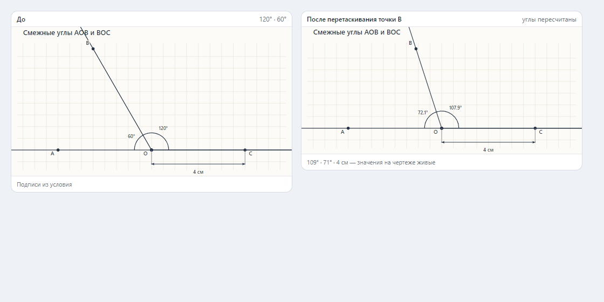
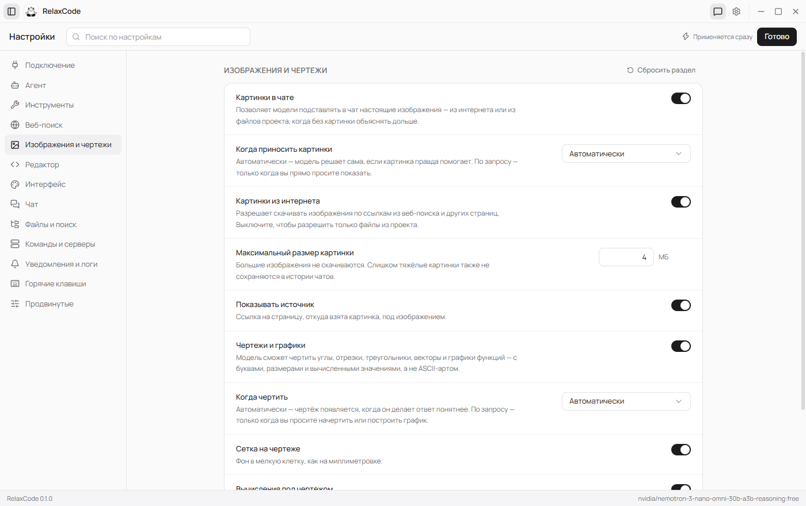

# RelaxCode

**RelaxCode** — настольная IDE с ИИ-агентом на Electron: файловый explorer, редактор Monaco и чат с агентом, который сам читает и правит файлы, запускает команды в реальном шелле, ищет в интернете и рисует схемы — а результаты сразу появляются в дереве проекта.

| Чат и агент | Настройки |
| --- | --- |
|  |  |

## Возможности

### ИИ-агент
- **Режимы чата**: обычный чат (только чтение), агент (полный доступ к инструментам) и план.
- **Steering во время работы**: пока агент работает, ввод активен — «вклиниться» (сообщение попадает в диалог на ближайшей границе шагов) или «в очередь» (выполнится после текущей задачи). Очередь видна в чате: поднять/опустить, вернуть в поле ввода, убрать; она переживает перезапуск приложения. Кнопки «Пауза» (брейк на границе шагов, текущий вызов инструмента дорабатывает), «Продолжить» и «Стоп».
- **Ночной автопилот**: переключатель-луна в поле ввода — полный автомат (подтверждения не нужны) в рамках жёстких лимитов из настроек: шаги, токены, время. Деструктивные команды ночью пропускаются с объяснением (ждать подтверждение некому), катастрофические запрещены всегда. Остановка по лимиту честно помечается в переписке.
- **20 инструментов**: работа с файлами (`read_file`, `write_file`, `edit_file`, `move_path`, `delete_path` — с корзиной), поиск по именам и содержимому, `run_command` в реальном шелле, фоновые dev-серверы (`start_server` / `stop_server`), git (`git_status`, `git_diff`), интернет (`web_search`, `fetch_url`), `show_image`, `draw_figure`, список задач `todo_write` и `ask_user`.
- **Стриминг с рассуждениями**: «мышление» модели показывается отдельными сворачиваемыми карточками.
- **Устойчивость к слабым моделям**: ретраи с backoff на 429/5xx, восстановление tool-call'ов, напечатанных текстом, срезание циклов повторов (RepetitionGuard), дожим финального ответа, авто-исправление языка ответа и предупреждения о сомнительных утверждениях.
- **Память о моделях**: наблюдения «эта модель зацикливается в reasoning» сохраняются на диск и учитываются в следующих сессиях.
- **Журнал обменов**: каждый диалог с инструментами и результатами пишется в `userData/exchanges` для разбора постфактум.

### Автономность и устойчивость
- **backup_file**: перед масштабной правкой агент снимает копию файла (.blend, .aep, конфиг) в `userData/backups` — история ограничена 20 последними версиями на файл, только файлы открытого workspace.
- **Watchdog MCP**: разрыв соединения при вызове (краш/перезапуск приложения) мгновенно помечает сервер и запускает авто-реконнект; вызов отвечает модели понятной ошибкой «сервер перезапускается, повторите один раз».
- **Бюджет схем инструментов**: при переполнении лимита (~48k символов) JSON-схемы MCP-инструментов деградируют по ступеням — сначала описания, потом параметры; имена инструментов сохраняются всегда.
- **Кадры ключевых шагов** Screen-панели сохраняются на диск (`userData/frames`, последние 200) вместе с журналом обменов.

### Безопасность и подтверждения
- У каждого инструмента уровень риска (`read / write / exec / delete`); настройки утверждения: `full-auto`, `auto-safe` или `ask`, плюс «всегда разрешать в этой сессии».
- Классификатор опасных команд: деструктивные требуют подтверждения, катастрофические (форматирование, удаление системных папок) отклоняются всегда.

### Редактор и файлы
- **Monaco Editor** с вкладками, иконками файлов, авто-сохранением (off / afterDelay / onFocusChange) и Ctrl+S.
- Файловый explorer: создание, переименование, перемещение, дублирование, удаление через корзину; правки агента появляются в дереве в реальном времени (chokidar).

### Чат-интерфейс
- Карточки вызовов инструментов с иконками, статусами и раскрываемыми результатами.
- **Markdown в ответах**: заголовки, списки (включая «--»-буллеты слабых моделей), `код` и код-блоки в рамках, цитаты — цветной выноской; `[n]`-источники остаются кликабельными. Рендер устойчив к недописанному стриму.
- **WebSearchCard** — источники с номерами и ссылками; **FigureCard** — интерактивные SVG-схемы (пан, зум, перетаскивание точек, экспорт); **ImageCard** — картинки, встроенные как data-URL (работают офлайн).
- **ContextMeter** — кольцевой индикатор заполнения контекстного окна по данным провайдера.
- Панели задач агента (todo) и фоновых процессов (dev-серверы с кнопками остановки).

### Приложения и MCP
- Агент подключается к внешним программам (Blender, Unity, Godot, After Effects — через их MCP-серверы) и управляет ими своими инструментами с префиксом `mcp__<сервер>__<инструмент>`.
- **Коннектор Blender** (эталонный): мастер в настройках находит установленный Blender (реестр, Program Files), ставит выделенную Python-среду в `userData/mcp-env`, устанавливает официальный аддон [mcp-for-blender](https://github.com/ahujasid/mcp-for-blender) (MIT) и регистрирует сервер; кнопка «Запустить» стартует Blender с авто-стартом MCP-сервера. Скриншоты вьюпорта (`look`) приходят в чат картинкой; рендер-превью агент делает через bpy и показывает в чате.
- **Палитра шедевров (адаптивно)** — инструмент `blender_recipe`: готовые сцено-операции с параметрами (clear_scene, terrain, forest, rocks, sunset_light, moon_light, camera_shot, render_preview, material_color, save_blend). Предлагается **только моделям, которые себя скомпрометировали** как слабые tool-callers (вызовы инструментов текстом, битый JSON аргументов, неизвестные инструменты — счётчик в памяти моделей, порог 3, стареет за 30 дней); сильные модели пишут свой bpy и палитры не видят. Слабой модели достаточно выбрать рецепт — весь bpy-код генерируется безошибочно; сцена собирается цепочкой рецептов.
- Конфиг `userData/mcp.json` в формате Claude Desktop: импорт готовых конфигов, экспорт (секретные переменные окружения в экспорт не попадают).
- **Playbook'и приложений**: для каждого подключённого сервера — markdown-инструкция агенту (какие инструменты вызывать первыми, как проверять результат, подводные камни), редактируется в карточке сервера и подгружается в промпт при активном соединении.
- **Доверие перед первым запуском**: сторонний сервер нельзя выполнить, пока пользователь не увидел его команду/аргументы/окружение и не подтвердил запуск; изменение команды сбрасывает доверие.
- Уровни риска для каждого инструмента (по умолчанию `exec`) переопределяются в интерфейсе; отдельные инструменты можно выключать.
- Статусы серверов `stopped / starting / ready / error` с журналом stderr и автопереподключением с ретраями (переживает перекомпиляцию Unity и перезапуск Blender).
- Результаты MCP-инструментов с картинками (base64) рендерятся в чате карточкой изображения — как `show_image`.
- Таймаут и отмена каждого вызова: зависший инструмент не вешает agent loop.

### Панель «Экран»
- Док справа от чата (Ctrl+Shift+E): **живой стрим** окна подключённого приложения через desktopCapturer в `<video>` — в родном разрешении окна, без искусственных потолков; свёрнутое окно автоматически разворачивается при подключении стрима (без кражи фокуса), а незапущенное можно запустить кнопкой прямо из подсказки.
- **Лента кадров**: после каждого вызова MCP-инструмента окно приложения снимается в JPEG (1024×576) с подписью шага (инструмент + результат); кадры можно открыть крупно и очистить.
- Вкладки по подключённым приложениям, ресайз перетаскиванием (ширина хранится в настройках), внятные причины вместо пустого экрана, когда окно не найдено или не захватывается.

### Провайдеры моделей
- Каталог из **218 провайдеров / 7 533 моделей** (генерируется из [models.dev](https://models.dev)): OpenAI, Anthropic, Google, OpenRouter, DeepSeek, xAI, Groq, Mistral, Cerebras, Together AI и другие.
- Любой OpenAI-совместимый endpoint как «свой провайдер»: настраиваемые base URL, модель, API-ключ (шифруется на диске и никогда не экспортируется), `extraBody` / `extraHeaders`, таймауты, прокси; несколько профилей подключений.
- Веб-поиск через **Tavily, Brave Search или Serper** со своим ключом.

### Прочее
- Интерфейс на **русском и английском** языках; язык ответов агента — отдельная настройка (ru / en / авто).
- Безрамочное окно с кастомным титлбаром, настраиваемые горячие клавиши (Ctrl+B — explorer, Ctrl+J — чат, Ctrl+Shift+E — экран), статус-бар с активной моделью.
- Терминал: выбор шелла (PowerShell / cmd / Windows Terminal), умное декодирование кодовых страниц Windows, подсказки cmd.exe для linux-команд.

## Технологии

- **Electron ^44** + **electron-vite ^6** (main / preload / renderer)
- **React 19**, **Zustand 5**, **Tailwind CSS 4**, **Radix UI**, **lucide-react**
- **Monaco Editor ^0.57**
- TypeScript ^7 (strict, ES2023)
- Runtime-зависимости минимумом: `openai`, `chokidar` и официальный `@modelcontextprotocol/sdk` (MIT) для внешних приложений

## Структура проекта

```
src/
  main/       # Main-процесс: агент, инструменты, MCP-менеджер, коннекторы приложений, терминал, IPC
  preload/    # Мост контекста (contextBridge)
  renderer/   # UI: чат, редактор, explorer, настройки
  shared/     # Типы IPC, i18n, каталог провайдеров, MCP-схема, общие утилиты
scripts/      # 18 тестов без зависимостей + mock MCP-сервер, smoke-прогон, генераторы
assets/       # Логотипы провайдеров и темы
```

## Запуск

```bash
npm install
npm run dev        # запуск в режиме разработки
npm run build      # production-сборка (out/)
npm run start      # preview production-сборки
```

## Тесты

Все тесты — самодостаточные Node-скрипты без внешних зависимостей:

```bash
npm test           # весь набор (19 suites)
npm run test:mcp   # ядро MCP + живой прогон против mock stdio-сервера
npm run smoke      # e2e-smoke: приложение против mock OpenAI + mock MCP-сервера (SMOKE_CHAT=1)
```

## Лицензия

MIT
