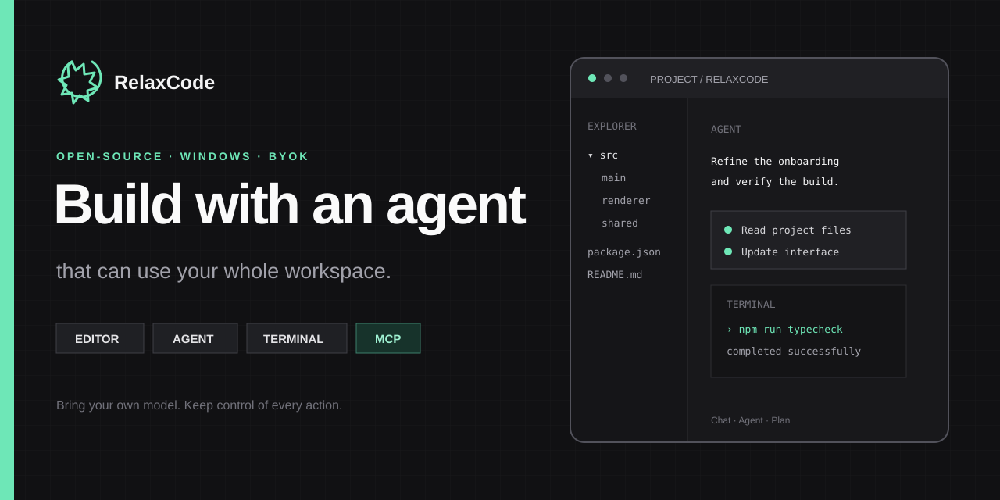
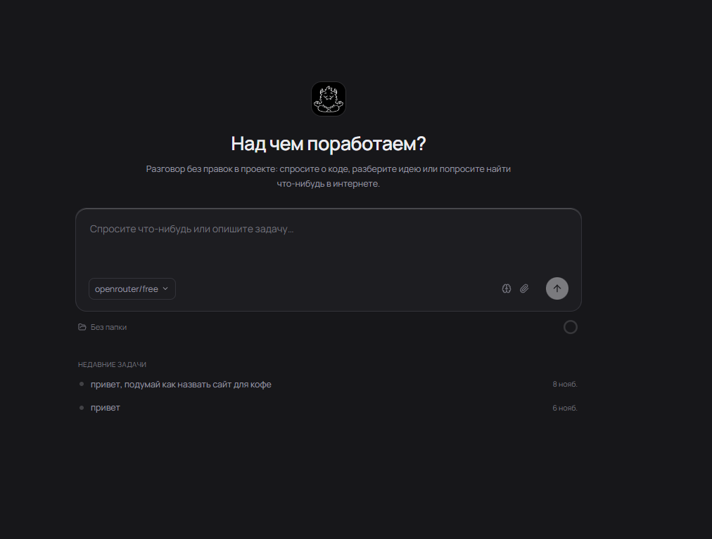

<div align="center">



# RelaxCode

**Открытая IDE для Windows, где ИИ может изучать проект, менять код, запускать настоящий терминал, искать в интернете и работать с MCP-приложениями.**

[](https://github.com/mikkya2123-ship-it/RelaxCode/releases/latest)
[](https://github.com/mikkya2123-ship-it/RelaxCode/releases)
[](LICENSE)

**[Скачать для Windows](https://github.com/mikkya2123-ship-it/RelaxCode/releases/latest)** · [English](README.md) · [Все возможности](docs/FEATURES.md) · [Планы](ROADMAP.md)

</div>

## Одно рабочее пространство вместо ещё одной вкладки с чатом

RelaxCode объединяет редактор Monaco, дерево проекта, терминал и агента, который умеет ими пользоваться. Подключайте своего провайдера и модель, подтверждайте рискованные действия и управляйте внешними приложениями через MCP.



| Возможность | Что это даёт |
| :--- | :--- |
| **Режимы Чат, Агент и План** | Обсудить вопрос, поручить изменения или сначала проверить план. |
| **Свои модели и ключи** | Выбрать модель из каталога или добавить OpenAI-совместимый endpoint. |
| **Настоящие инструменты проекта** | Читать и менять файлы, искать код, запускать команды и проверять Git diff. |
| **MCP-приложения** | Работать с Blender и поддерживаемыми приложениями ArtCraft из диалога. |
| **Контроль действий** | Подтверждения, пауза, остановка, очередь задач, уровни риска и лимиты. |
| **Визуальные ответы** | Показывать изображения и интерактивные SVG-схемы прямо в чате. |

## Быстрый старт

1. Скачайте `RelaxCode-Setup-0.3.0.exe` из [последнего релиза](https://github.com/mikkya2123-ship-it/RelaxCode/releases/latest).
2. Установите RelaxCode на Windows 10 или 11 (x64).
3. Откройте **Настройки → Подключения**, выберите провайдера и укажите API-ключ.
4. Откройте папку проекта и поставьте агенту конкретную задачу.

> [!NOTE]
> Приложение пока не подписано цифровым сертификатом, поэтому Windows SmartScreen может показать предупреждение. Скачивайте установщик только со страницы Releases этого репозитория. Стоимость API зависит от выбранного провайдера.

## Модели и приватность

- Каталог на основе [models.dev](https://models.dev) содержит тысячи моделей более чем 200 провайдеров.
- Поддерживаются OpenAI, Anthropic, Google, OpenRouter, DeepSeek, xAI, Groq, Mistral и свои OpenAI-совместимые API.
- API-ключи шифруются локально и не попадают в экспорт профилей подключения.
- Запросы и выбранный контекст проекта отправляются напрямую настроенному вами провайдеру; собственного прокси у RelaxCode нет.

## Разработка

Понадобятся Windows, Node.js 24 и npm.

```powershell
git clone https://github.com/mikkya2123-ship-it/RelaxCode.git
cd RelaxCode
npm ci
npm run dev
```

| Команда | Назначение |
| :--- | :--- |
| `npm run typecheck` | Проверка TypeScript в Electron и интерфейсе |
| `npm test` | Запуск набора Node-тестов |
| `npm run build` | Сборка приложения в `out/` |
| `npm run dist` | Сборка установщика Windows в `dist/` |

Подробнее: [возможности](docs/FEATURES.md), [планы](ROADMAP.md), [участие в разработке](CONTRIBUTING.md), [история изменений](CHANGELOG.md) и [политика безопасности](SECURITY.md).

Обсудить идею можно в [GitHub Discussions](https://github.com/mikkya2123-ship-it/RelaxCode/discussions), а сообщить об ошибке — через [готовую форму](https://github.com/mikkya2123-ship-it/RelaxCode/issues/new?template=bug_report.yml).

RelaxCode распространяется по [лицензии MIT](LICENSE).
